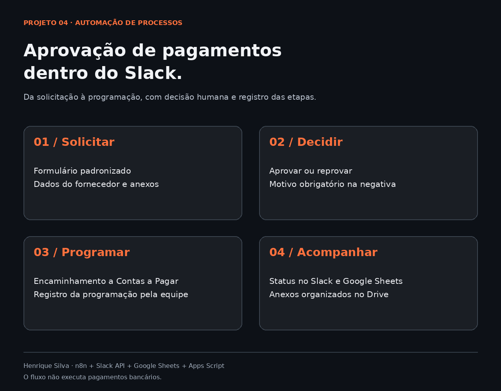
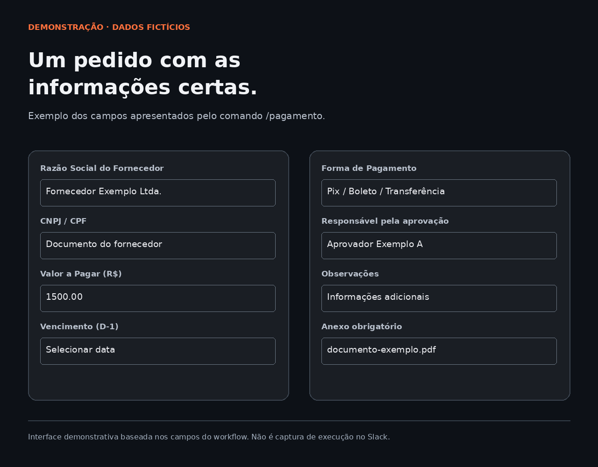
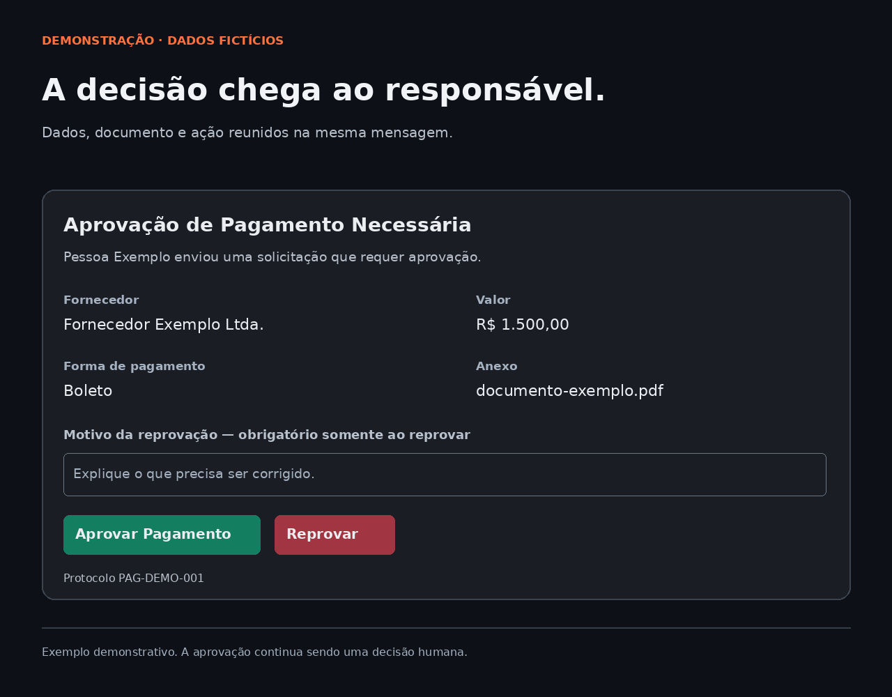
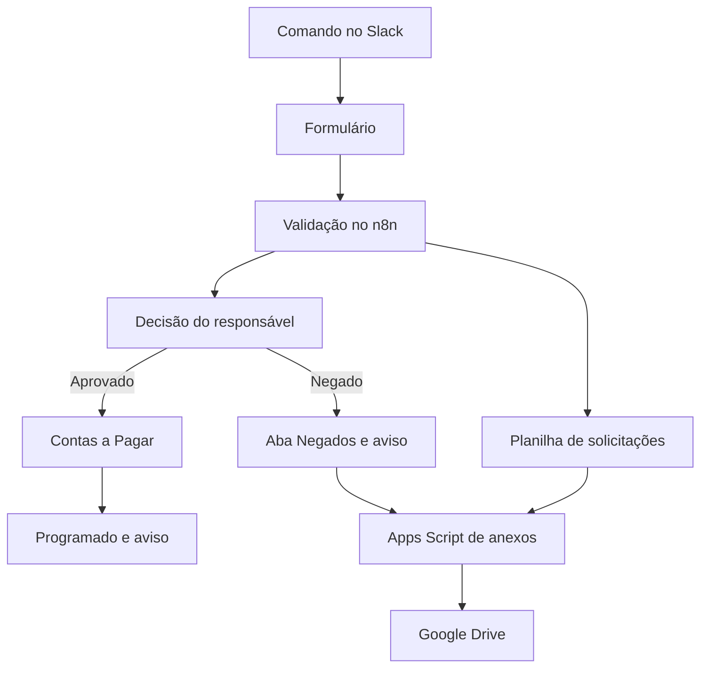

# Aprovação de pagamentos pelo Slack

**Solicitação, decisão e programação em um processo acompanhado pelo Slack.**

Projeto de Henrique Silva com **n8n, Slack API, Google Sheets e Google Apps Script**. Antes, as solicitações chegavam por mensagens soltas, sem uma estrutura padronizada. A automação organiza os dados do pedido, reúne anexos, encaminha para aprovação e informa o solicitante sobre o andamento.

> Versão pública adaptada do workflow fornecido pelo autor: 46 nós, conexões preservadas e dados internos substituídos. Preparada para portfólio e estudo. Configuração e homologação são necessárias antes de usar com dados reais. O fluxo não realiza transferências bancárias e seu estado final é **PROGRAMADO**.



## Como funciona

1. A pessoa digita `/pagamento` no Slack e preenche um formulário com fornecedor, documento, valor, vencimento, forma de pagamento, aprovador e anexos.
2. O n8n valida campos específicos e registra a solicitação no Google Sheets com um protocolo.
3. O responsável recebe os dados no Slack e aprova ou reprova. A reprovação exige um motivo.
4. Se aprovado, o pedido segue para dois destinatários de Contas a Pagar e o solicitante é avisado.
5. Um responsável registra **“Marcar como Programado”**. O fluxo atualiza a planilha e informa o solicitante.
6. Em execução separada, o Apps Script copia anexos acessíveis do Slack para o Google Drive e registra os links.

A aprovação e a programação são decisões humanas. Não há confirmação automática de liquidação bancária.

## Demonstrações públicas

Estas telas são ilustrações de interface com dados fictícios, baseadas nos campos e mensagens do workflow. Há também versões HTML editáveis em assets/. São exemplos de interface, não prints de execução da versão pública. Os prints recebidos continham dados pessoais e informações internas e foram excluídos do pacote.





## Arquitetura



O Apps Script possui agendamento independente. A frequência do ambiente original não foi informada e nenhum gatilho foi criado neste pacote.

## Conteúdo

| Caminho | Conteúdo |
|---|---|
| `workflow/aprovacao-pagamentos.public.json` | Workflow n8n completo, desativado, sem vínculos de credenciais |
| `workflow/code/` | Código dos nós separado para consulta; o JSON é a fonte de importação |
| `apps-script/Anexos.gs` | Cópia de anexos com configuração externa e retomada por solicitação |
| `examples/estrutura-planilha.json` | Cabeçalhos e nomes das abas |
| `examples/config.example.json` | Mapa de configurações para uma cópia privada |
| `scripts/configurar-local.cjs` | Gera JSON configurado dentro de `private/` |
| `docs/INSTALACAO.md` | Passo a passo de configuração e teste |
| `docs/REVISAO.md` | Mudanças, limitações e pontos necessários antes de produção |
| `docs/PUBLICAR.md` | Comandos completos para commit e push |
| `docs/LINKEDIN.txt` | Rascunho do post 4, com espaçamento para copiar |
| `assets/` | Demonstrações públicas e fonte HTML editável |
| `tests/validar.cjs` | Validação local de estrutura, sintaxe e comportamento dos anexos |

## Usar para estudo

Importe `workflow/aprovacao-pagamentos.public.json` no n8n para visualizar os nós. Os valores `CONFIGURE_*` e `UDEMO*` são exemplos e impedem uso direto. Se quiser configurar uma cópia de teste, siga [INSTALACAO.md](docs/INSTALACAO.md). Importação real no n8n e chamadas externas não foram executadas na preparação desta entrega.

## Validação local

Com Node.js instalado, execute:

```bash
node tests/validar.cjs
```

O teste verifica estrutura JSON, conexões, referências de nós, sintaxe JavaScript e cenários simulados do processamento de anexos. Ele não substitui homologação de permissões, mensagens Slack, expressões do n8n, quotas e concorrência entre serviços.

## Resultados e limites

O projeto padroniza solicitações antes dispersas em conversas e registra os responsáveis pelas decisões. Não foram incluídos percentuais, horas economizadas ou valores financeiros de resultado, pois essas métricas não foram validadas.

O workflow preserva o comportamento recebido e precisa de ajustes de segurança e consistência antes de exposição pública: verificação da assinatura Slack, autorização por responsável, controle de concorrência e tratamento de falhas parciais. Veja [a revisão técnica](docs/REVISAO.md).

**Autor:** [Henrique Silva](https://github.com/Hsilva68) · [HenriFlow](https://henriflowtecnologia.com.br/)
